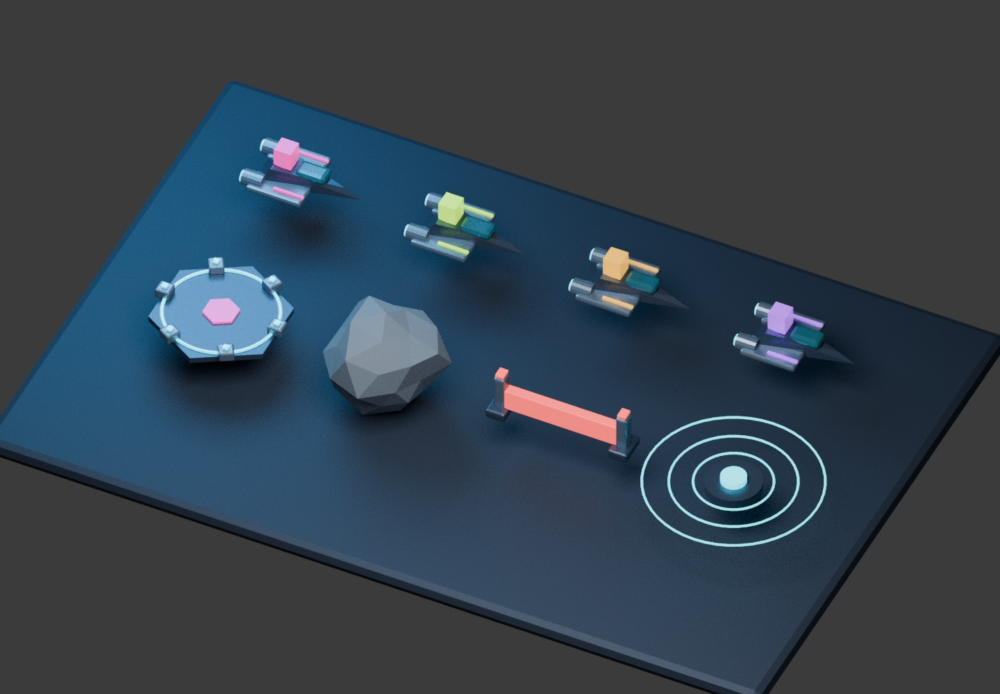

# Zero-G Cargo — 50-sector 3D campaign

An offline Android path-drawing puzzle for **Unity 6.6 / 6000.6.7f1**. Draw routes for cargo shuttles, anticipate inertia, avoid station hazards and dock at matching bays.

The repository now contains **50 campaign levels**, original modelled 3D assets, a station backdrop, local progression, sound/music/haptic settings, win/fail flow and an APK build command. **This is a development build candidate, not a device-validated finished release. No APK has been compiled in the cloud.** Unity import, 3D rendering, Android compilation, performance and human difficulty testing remain required on a licensed Unity machine.



*Blender render of the exported models; not a Unity gameplay screenshot.*

## Run on your laptop

1. Pull `master`, clone with GitHub Desktop, or extract a fresh GitHub ZIP into a new folder. The bundled model and menu assets are ordinary repository files, so the ZIP includes them. Git LFS rules remain available for future large art.
2. Open the repository root in **Unity Hub**, using **Unity 6.6 (6000.6.7f1)**. Allow URP 17.5.0 and uGUI 2.6.0 to resolve.
3. Run **Zero-G Cargo → Prepare game**. The old Prepare prototype menu is retained as an alias. Preparation creates a **3D Universal Renderer**, shader templates, TMP essential resources, Orbitron/Inter font assets and Android defaults. Old 2D pipeline assets are preserved but are no longer selected.
4. If preparation changes Active Input Handling, restart Unity. This version uses **Input Manager (Old)**.
5. Open `Assets/_Project/Scenes/Boot/Boot.unity`, select **9:16** in the Game view and press Play. Select Begin shift or an unlocked sector.
6. Drag from any stationary shuttle to the bay with the matching cargo colour. Release to launch. A stopped short route can be continued. Collisions return that shuttle to its spawn. Timed sectors fail when the frame arc fills. Late bays remain small/locked until their dependency is delivered.

## Make the phone APK

The APK must be compiled by Unity; this cloud has neither the Unity Editor nor a Unity licence. Your laptop must have a valid Unity licence and **Android Build Support + SDK/NDK Tools + OpenJDK** installed through Hub.

1. Run Prepare game and check the Console for errors.
2. In **File → Build Profiles**, switch to **Android**.
3. Select **Zero-G Cargo → Build phone test APK**.
4. On success, copy **`Builds/ZeroGCargo-phone-test.apk`** to an **ARM64 Android 8.0/API 26+** phone. Open it and allow installation from that source when Android asks.

Alternatively, close the project in Unity and run the Windows build script from PowerShell:

```powershell
.\scripts\build-phone-apk.ps1
```

The script runs without the editor graphics window and limits Unity job workers to two to reduce concurrent work; this does not cap every shader/compiler process or guarantee a low-memory build. It checks Unity's exit status, requires an actual APK file and prints its SHA-256. Logs go to `Builds/phone-build.log`. This APK uses Android's development signing key but disables Unity's development-player features. It is for testing, not a Play Store release. If an older APK with another signing key is already installed, Android may refuse the update; preserve any wanted save data before uninstalling.

If Unity reports **Out of memory**, follow [the build-memory troubleshooting steps](docs/BUILD_MEMORY.md) before retrying.

## What is included

- Four modelled cargo shuttles, hexagonal dock, meteorite, energy emitter, gravity generator and a panelled station deck. FBX files are in `Assets/_Project/Resources/Models`; editable Blender source and rebuild script are in `art-source`.
- A 50-tile scrollable sector map, progressive unlocks, best stars and local score. No lives, purchases, banners, accounts, backend or telemetry.
- Early untimed teaching levels; later multi-cargo routes, time limits, repulsor fields, drifting meteorites, gravity and delivery dependencies. Collision recovery, brief early ghost guides, dock sparkles and synthesized audio.
- Rounded UI, supplied OFL Orbitron/Inter fonts and an original generated station backdrop.
- Strict level-data validation, save-size bounds, atomic save/backup recovery and future-schema write protection. Android build hooks disable application backups and cleartext networking. See [security limitations](docs/SECURITY.md).
- A campaign editor with coordinate snapping, validation and solution simulation: **Zero-G Cargo → Campaign editor**.

## Tests and limits

Install .NET SDK 8.0.419 and run:

```sh
dotnet run --project Tests/Core/ZeroGCargo.Core.Tests.csproj --configuration Release
```

The same C# simulation is compiled into Unity. The current suite has **96 checks**, including successful simulation solutions for all 50 levels, matching/docking, collisions, force fields, timer failure, delivery dependencies, one-shot events, save handling and C# syntax parsing. GitHub Actions runs it on pushes.

These checks do **not** compile against Unity assemblies, execute Package Manager or establish Android performance. Every level tightens authored drift and later per-delivery time constraints; more hazard types and dependencies appear by tier. **That is a designed difficulty progression, not proof each level is harder for every player.** Human playtests and tuning are still required before claiming a complete, engaging release. See [validation](docs/VALIDATION.md) and [campaign design](docs/CAMPAIGN.md).

AdMob/Firebase integrations from the original specification are not installed. Offline phone testing needs no credentials; no fake ad rewards or analytics integrations are presented as working. The original ten specifications remain archived in `docs/specifications`.
